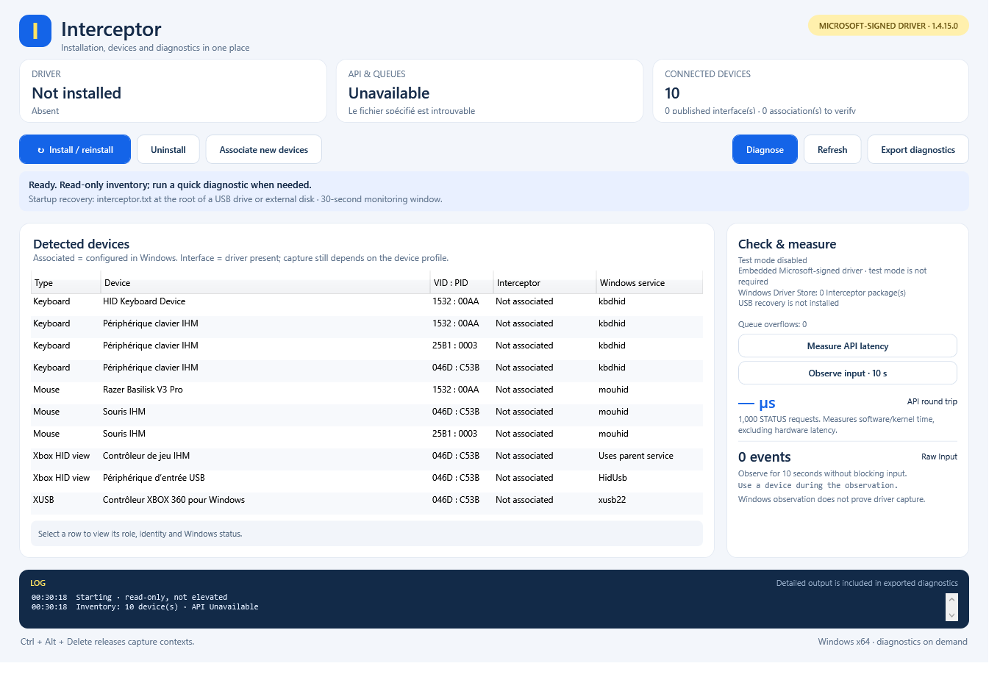
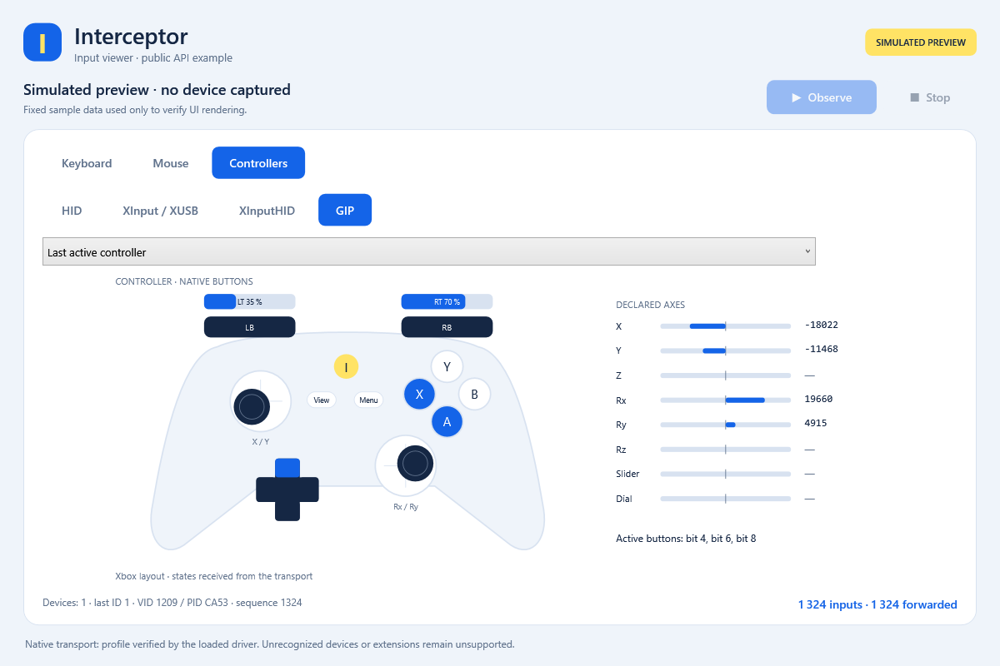

# Interceptor - Windows Kernel Filter Driver for Keyboard, Mouse and Gamepad

Capture physical input, identify its source, modify or block it, and forward it
to Windows with a **Microsoft-signed kernel filter driver** and a **two-file
C++17 SDK**. Supports keyboard, mouse and compatible HID, XInput/XUSB,
XInputHID and GIP controllers on **Windows 10 1709+ / Windows 11 x64**.

<!-- full-version-contact:start -->
> [!IMPORTANT]
> **Get the full version without demo restrictions**
>
> **Discord username: `titancsa`**
>
> Open Discord, choose **Friends > Add Friend**, enter **`titancsa`**, then send a direct message. Ask for the **full version without the demo time limit**, and mention **Interceptor**.
>
> Tell me whether you need personal use, business integration or OEM redistribution, and ask for pricing and license / activation instructions.
<!-- full-version-contact:end -->

**[Download](https://github.com/TitanCSA/Interceptor/releases/latest)** |
[Installation](docs/INSTALLATION.md) | [C++ API](docs/API.md) |
[Examples](Examples/Console/README.md) | [Compatibility](docs/COMPATIBILITY.md)

| Setup and diagnostics | Input viewer |
| --- | --- |
|  |  |

Screenshots illustrate the interface; the controller preview uses simulated input.

<a id="quick-start"></a>

## Install and use

1. Download **InterceptorSetup.exe** from this repository's latest release.
2. Run it, accept the administrator prompt and choose **Install / reinstall**.
3. If requested, use Windows **Restart**, then reopen setup to finish associations.
4. Open **InterceptorExampleUI.exe** and accept the administrator prompt.
   Observation starts automatically. Tabs select the displayed family.
   **Stop** releases capture. Run one capture app at a time.
5. Use **Diagnose** to check installation and export or copy a per-device report.

For command-line installation or removal, use the same release's console installer:

```powershell
.\InterceptorSetupConsole.exe /install
.\InterceptorSetupConsole.exe /uninstall
```

Exit code `3010` requests a restart. After installation, rerun `/install` if setup
still has pending associations. The GUI also provides **Uninstall**.
The Microsoft signature covers the driver package; installer and example EXEs
have their own signature status. [Installation and recovery](docs/INSTALLATION.md).

## How it works

The filter sits in the supported physical device's Windows input stack. Without
a capture owner, input passes through normally. An application receives input
batches, changes typed fields or marks events blocked, then sends the batch back
through the filter. Closing the application releases its capture.

| Family | Input path |
| --- | --- |
| Keyboard and mouse | Associated Windows input paths and supported HID mapper collections |
| HID controller | Descriptor-based axes, triggers, buttons, hats and other declared controls |
| XInput / XUSB | Compatible wired USB source beneath the native Windows XUSB driver |
| XInputHID | Supported HID collection beneath the Windows translator |
| GIP | Compatible USB gamepad protocol, including the standard state and Guide input |

Compatible profiles include **DualShock 4 / DS4 (PS4), DualSense (PS5), wired
Xbox 360, Xbox One and Xbox Series X|S**. Support depends on connection,
descriptor and protocol; see the [controller matrix](docs/COMPATIBILITY.md#console-gamepads).
Setup lists Windows device nodes, so one physical controller can have several rows.

## Other application languages

[Interceptor MultiLang](https://github.com/TitanCSA/Interceptor-MultiLang)
provides a C ABI and Python, Node.js/TypeScript, .NET, Java, Go and Rust wrappers
for the matching **combined Interceptor** release. Start with its release
packages and language examples; check the required runtime and driver version.
The wrappers are not compatible with the split Keyboard & Mouse, controller-only
or Interception V2 editions merely by changing headers. Wrapper/SDK source is
MIT; the matching demo driver keeps its own one-hour-per-kernel-boot demo and
separate full-version terms.

## C++ SDK

### Choosing between Interceptor and Windows Input Bridge

This edition uses `Get_Input_With_Timeout()` / `Send_Input()`.
[Windows Input Bridge](https://github.com/StrikeFound/Windows-Input-Bridge)
offers `Read()` / `Write()` and a move-only batch. The APIs are not drop-in
replacements: use each edition's matching SDK, driver and examples. If an
application already uses this API, keep its matching edition until you port and
test it. Compare the published validation scope and test your real devices.
Follow each edition's uninstall/restart instructions before switching overlapping
input filters; changing headers alone does not switch the installed driver.

Add [`Interceptor.h`](Interceptor/Interceptor.h) and
[`Interceptor.cpp`](Interceptor/Interceptor.cpp) to a Windows x64 C++17 project.
Include the header and compile the source once. No Interceptor DLL or prebuilt
LIB is required. Run capture applications as administrator.

`Get_Input_With_Timeout()` automatically creates and reuses the capture session.
It returns a mixed batch; `Send_Input(inputs)` determines the input types,
destinations and counts. HID state is decoded from the device descriptor.
Finish and forward each batch before receiving another one, including families
you do not modify. [API reference](docs/API.md).

<a id="source-and-build"></a>

## Downloads and source

Demo/evaluation driver source is available; see [driver/README.md](driver/README.md) for
build instructions and separate evaluation-source terms. Those terms apply to
Titan-authored driver code. Third-party source licenses and existing application/SDK
licenses remain applicable. Full/commercial implementation and private signing or
activation material are excluded.

The [latest release](https://github.com/TitanCSA/Interceptor/releases/latest)
contains both standalone installers, the standalone viewer, an examples ZIP,
a source SDK ZIP and **SHA256SUMS.txt**. Use matching driver, SDK and examples
from the same release. Updating the viewer alone does not update the driver.

For raw relative mouse movement, extract the examples ZIP and run
`09_Mouse_Move_Horizontal.exe` as administrator. Enter `300` or
`-485`, then press Enter to send that value directly as mouse X input.
See the [example instructions](Examples/Console/README.md#move-the-mouse-using-raw-relative-x-input).

```text
Interceptor/       Interceptor.h and Interceptor.cpp
Examples/
  Console/         Independent keyboard, mouse and controller C++ examples
  UI/              Graphical input viewer
Installer/
  Console/         Console installer
  UI/              GUI, shared setup engine and compiled driver/recovery binaries
docs/              Installation, API, compatibility and screenshots
licenses/          Driver terms and attribution
```

With Visual Studio 2022 C++ tools, a Windows SDK and CMake available, run
`powershell -ExecutionPolicy Bypass -File .\Build.ps1` to build the user-mode tools.
The signed driver and recovery binaries are supplied; **Demo/evaluation driver source is documented in [driver/README.md](driver/README.md)**. User-mode source is [MIT](LICENSE); the driver has
[separate terms](licenses/BINARY-LICENSE.txt).

For controller-only capture, use [Interceptor Gamepad & Controller](https://github.com/TitanCSA/Interceptor-Gamepad-Controller).
For keyboard/mouse-only capture, use [Interceptor Keyboard & Mouse](https://github.com/TitanCSA/Interceptor-Keyboard-Mouse).
Remove an overlapping combined edition before installing a split edition.

## Demo edition

Capture and injection are available for **one hour per Windows kernel boot**,
starting with the first capture, controller monitor subscription or raw GIP
diagnostic access, and shared across applications.
Sleep time counts; closing or reinstalling does not reset the allowance.
Diagnostics that capture input can start it. At expiry, capture stops and
physical input passes through normally. Use Windows **Restart** for a new
allowance; Fast Startup shutdown does not reset the kernel boot.
For the unrestricted version, DM **`titancsa`** on Discord.

Interceptor independently evolves the input-interception workflow popularized by
[oblitum/Interception](https://github.com/oblitum/Interception), with its own
implementation and API. It is not affiliated with oblitum or ABI-compatible with
the original. [Attribution](licenses/NOTICE).

## Minimal example: receive, read, change, forward

Install Interceptor, restart Windows if requested, and run your application as
administrator. Add `Interceptor.h` and `Interceptor.cpp` to a C++17 project
([build instructions](docs/API.md#add-the-two-files-to-your-application)).
This example changes the physical H key into J and forwards all other input:

```cpp
#include "Interceptor.h"
#include <iostream>
#include <system_error>

int main() try {
    using namespace Interceptor;
    const auto init = Init_AllDevices();
    if (!init.ready) {
        std::cerr << "Initialization error: " << init.error
                  << ", restart required: " << init.reboot_required << '\n';
        return 1;
    }

    for (;;) {
        auto inputs = Get_Input_With_Timeout(1000);
        for (auto& input : inputs) {
            if (auto* key = input.Get<Keyboard_Input>()) {
                // Read the scan code; change H (0x23) into J (0x24).
                if (!(key->stroke.flags & (KeyE0 | KeyE1)) &&
                    key->stroke.make_code == 0x23)
                    key->stroke.make_code = 0x24;
            }
        }
        const auto sent = Send_Input(inputs);
        if (!sent) {
            std::cerr << "Send error: " << sent.error << '\n';
            return 1;
        }
    }
} catch (const std::system_error& error) {
    std::cerr << error.what() << '\n';
    return 1;
}
```

1. **Receive:** `Get_Input_With_Timeout(1000)` waits up to 1,000 milliseconds
   for input. It returns a batch you can loop over, or an empty batch on timeout.
   Each `input` in the loop is one event; `inputs.size()` gives the event count.
   The library creates and reuses its capture automatically; no context argument
   is needed. `Get_Input_With_Timeout()` waits indefinitely instead.
2. **Read:** `input.Get<Keyboard_Input>()` returns the keyboard data, or `nullptr`
   if this entry belongs to another family. `key->stroke.make_code` is the scan
   code, not a character; `(key->stroke.flags & KeyUp) != 0` means key release.
   `input.type` gives the family; `input.device` identifies its source within that
   family. For mouse data, use `if (auto* mouse = input.Get<Mouse_Input>())` and
   read `mouse->stroke.x` / `mouse->stroke.y`.
3. **Change:** assign a new value to a field. Here both H presses and releases
   become J, while the other flags stay intact. These are physical scan-code
   positions; the resulting character depends on the Windows keyboard layout.
   Remove the `if` that changes the scan code for a simple pass-through loop.
4. **Forward:** `Send_Input(inputs)` sends the batch back to its original
   devices. Type, destination and count are automatic. Unchanged keyboard,
   mouse and controller entries are forwarded too. Without this call, received
   entries are consumed and are not forwarded automatically.

`Send_Input` returns `accepted` (entries accepted by this call) and `error`
(`0` on success). This basic example exits on an error; see the
[API guide](docs/API.md#input-fields-and-ownership) for retry handling.
Finish processing and forwarding a batch before receiving the next one; its
data is valid only while that batch exists. Close the application or press
physical **Ctrl+Alt+Delete** to release capture.

## Responsible use and disclaimer

This project, including its drivers, SDKs, libraries, applications, installers and examples, was created for lawful, constructive purposes such as accessibility, device customization, research, testing and software development. Illegal, malicious or unauthorized use is neither intended nor endorsed by TitanCSA or the contributors.

You are solely responsible for how you use, modify or distribute the software, for obtaining any necessary authorization, and for complying with applicable laws, third-party rights and service rules. TitanCSA and the contributors do not accept responsibility for users' actions, including illegal activity or misuse of the drivers or SDKs.

To the maximum extent permitted by applicable law, the software is provided "AS IS", without warranties of any kind, and TitanCSA and the contributors are not liable for claims, damages, data loss, system damage or other consequences arising from its use or misuse. Nothing in this notice excludes liability that cannot legally be excluded. Existing project and third-party license terms remain applicable.

<!-- central-sdk-packages:start -->
## SDK : langages et installation

Les sources, licences, guides API et exemples sont regroupes dans [le depot SDK dedie](https://github.com/TitanCSA/sdk-packages/tree/main/projects/Interceptor). Choisis le langage de ton application puis execute sa commande dans son dossier.

| Langage / registre | Disponibilite | Installation / utilisation |
| --- | --- | --- |
| C++ / vcpkg | Registre TitanCSA disponible (configuration ci-dessous) | `vcpkg install interceptor:x64-windows` |
| C++ / Conan | Registre TitanCSA disponible (configuration ci-dessous) | `conan install --requires=interceptor/1.4.22 -r titancsa --build=missing -s compiler.cppstd=17` |
| C++ / NuGet natif | Publie et verifie | `Install-Package Interceptor.Native -Version 1.4.22` |
| C# / .NET | Publie et verifie | `dotnet add package Interceptor.SDK --version 1.0.0` |
| Python / pip | Pas encore disponible / validation en cours | Commande prevue apres publication : `python -m pip install interceptor-sdk==1.0.1` |
| Python / Conda | Canal TitanCSA disponible ; acceptation conda-forge encore en attente | `conda install --override-channels -c https://raw.githubusercontent.com/TitanCSA/sdk-packages/089bc73095aa8eda89bacbe10d0b9e58394b0207/conda-channel -c conda-forge interceptor-sdk` |
| Rust / Cargo | Publie et verifie | `cargo add interceptor-sdk@1.0.0` |
| JavaScript et TypeScript / npm | Publie et verifie | `npm install interceptor-sdk@1.0.0` |
| Java et Kotlin / Maven Central | Publie et verifie | `io.github.titancsa:interceptor-sdk:1.0.0 (pom.xml / Gradle)` |
| Java et Kotlin / JitPack | Publie et verifie | `com.github.TitanCSA:Interceptor:java-sdk-v1.0.0 (avec le depot JitPack)` |
| Go / Go Modules | Publie et verifie | `go get github.com/TitanCSA/Interceptor/Interceptor-Go-modules@v1.0.0` |
| Go / pkg.go.dev | Publie et verifie | `Documentation : https://pkg.go.dev/github.com/TitanCSA/Interceptor/Interceptor-Go-modules@v1.0.0` |
| PowerShell / Gallery | Publie et verifie | `Install-Module Interceptor -RequiredVersion 1.0.0 -Scope CurrentUser` |
| Dart et Flutter / pub.dev | Publie et verifie | `dart pub add interceptor:1.0.0` |
| Ruby / RubyGems | Publie et verifie | `gem install interceptor-sdk -v 2.0.0` |
| PHP / Composer | Pas encore disponible / validation en cours | Commande prevue apres publication : `composer require titancsa/interceptor:1.0.0` |

Pour vcpkg et Conan, configure d abord le registre TitanCSA avec [le guide complet](https://github.com/TitanCSA/sdk-packages/tree/main/projects/Interceptor/README.md). Le guide explique aussi Maven/Gradle, les prerequis et le chargement des DLL. Les pilotes/applications du produit sont installes separement. Les commandes marquees prevues ne sont pas encore disponibles.

Les anciens imports Go et versions JitPack gardent leurs tags. Pour les anciennes archives SDK, utilise [les liens de remplacement](https://github.com/TitanCSA/sdk-packages/blob/main/release-assets/URL-MIGRATION.json).
<!-- central-sdk-packages:end -->
