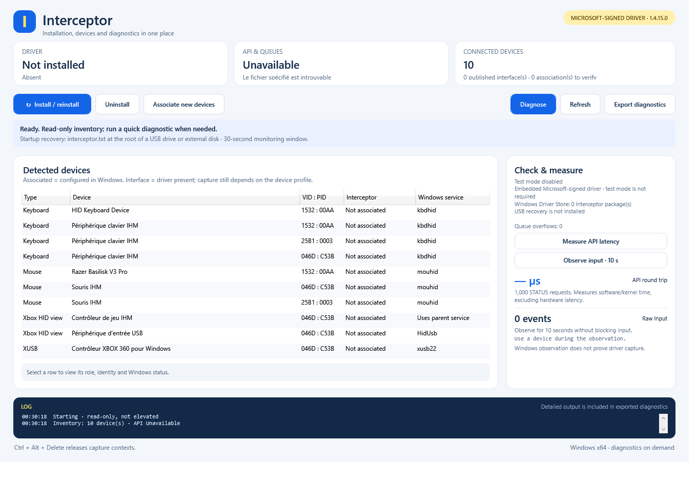
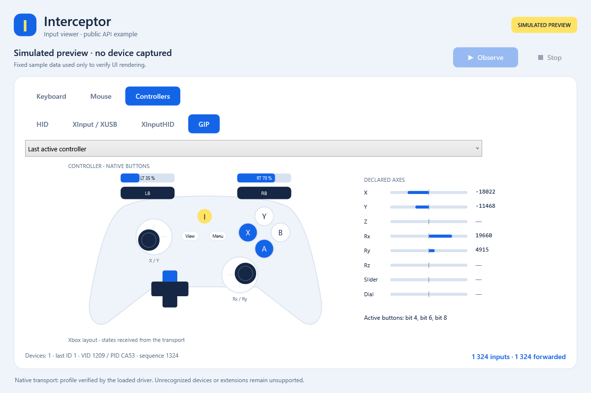

# Interceptor — Windows Kernel Driver

**Microsoft-signed Windows kernel-mode input filter driver for keyboards, mice
and HID / XInput / GIP game controllers, with a C++17 SDK.**

Intercept physical input, identify its source, change or block it, then forward
it to Windows through one API. Windows 10/11 **x64**; administrator rights required
for installation and capture. See the [supported profiles](docs/COMPATIBILITY.md)
for device and connection limits.

**[Download](https://github.com/TitanCSA/Interceptor/releases/latest)**
· [Installation](docs/INSTALLATION.md) · [C++ API](docs/API.md)
· [Examples](examples/console/README.md)

| Setup and diagnostics | Controller viewer |
| --- | --- |
|  |  |

The installer is shown before installation; Windows device names follow the OS
language. The controller image is a simulated preview, not a physical-device test.

## Quick start

1. Download and run **InterceptorSetup.exe**, then accept Windows elevation.
2. Click **Install / reinstall**. If requested, use Windows **Restart**, then
   reopen the same installer to finish device associations.
3. Launch **InterceptorExampleUI.exe** and click **Observe** to view and forward
   inputs. **Stop** ends capture. Close other capture applications first.
4. Use **Diagnose** for per-device checks and a report you can copy or export.
   Checks without suitable input activity remain **unverified**.

The console installer uses the same installation engine:

```powershell
.\InterceptorSetupConsole.exe /install
.\InterceptorSetupConsole.exe /uninstall
```

Exit code `3010` means restart required; after installing, rerun `/install` after
that restart. [Installation, diagnostics and recovery](docs/INSTALLATION.md).

## C++ SDK

`Get_Input_With_Timeout()` receives a mixed input batch. Modify typed fields or
mark individual events blocked, then call `Send_Input(inputs)` to forward it.
The library manages its session and infers send types and sizes. HID controller
state exposes dynamic axes, triggers, hats and buttons from the device descriptor.

Start with the [complete H-to-J example](examples/console/08_Clavier_Minimal.cpp)
or the [API guide](docs/API.md). Forward untouched families too: receiving a batch
consumes its input. Closing the application releases capture; physical
**Ctrl+Alt+Delete** also revokes captures.

## Demo edition

**Two hours per Windows boot**, starting with the first successful capture,
shared across all applications and devices. Time spent asleep counts; closing an
application or reinstalling does not reset it. Diagnostics that capture input
can start the allowance. After expiry, capture/injection stop and physical input
continues normally. Use Windows **Restart** for another allowance; Fast Startup
shutdown does not reset the kernel boot.

For the **full version without the demo time limit**, DM **`titancsa`** on Discord.

## Downloads

All files and checksums are in [Releases](https://github.com/TitanCSA/Interceptor/releases/latest).
The driver's Microsoft signature does not automatically sign the installer or
example EXEs.

| File | Contents |
| --- | --- |
| `InterceptorSetup.exe` | Standalone GUI installer and diagnostics |
| `InterceptorSetupConsole.exe` | Standalone `/install` and `/uninstall` installer |
| `InterceptorExampleUI.exe` | Standalone input viewer |
| `Interceptor-Examples-1.4.15.0.zip` | Eight console examples and the viewer |
| `Interceptor-SDK-1.4.15.0.zip` | C++ SDK and example source |

## Source and build

```text
sdk/         C++ library and internal protocol headers
examples/    console examples and graphical viewer
installer/   UI, console, recovery, helper and package engine
tools/       user-mode build and packaging scripts
docs/        API, installation, compatibility and images
licenses/    driver binary terms and attribution
```

With Visual Studio 2022 C++ and the Windows SDK installed, run
`powershell -ExecutionPolicy Bypass -File .\Build.ps1`. This builds user-mode
components and reuses the pre-signed demo driver. **Kernel driver source and
private signing material are not included.** User-mode source is [MIT](LICENSE);
the driver binary has [separate terms](licenses/BINARY-LICENSE.txt).

Interceptor independently evolves the input-interception workflow popularized by
[oblitum's Interception](https://github.com/oblitum/Interception), with its own
implementation and API. It is not affiliated with oblitum or ABI-compatible with
the original. See [attribution](licenses/NOTICE). For bug reports, include the
release, Windows build, VID/PID, connection type and a diagnostic report with
personal identifiers removed.