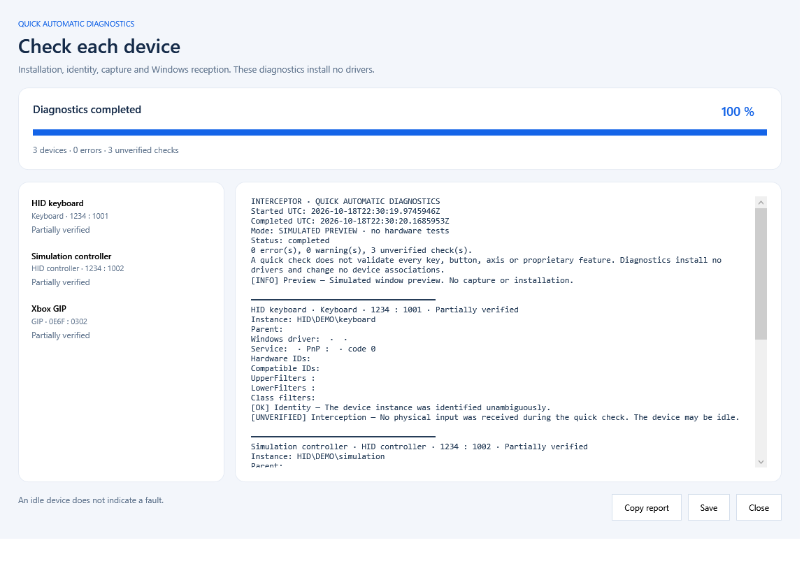

# Install, use and remove the Interceptor kernel driver

## Requirements

- Windows 10 or Windows 11, **x64**.
- Administrator rights for setup, device association and input capture/injection.
- A supported device profile; see [compatibility](COMPATIBILITY.md).

The release setup EXEs are standalone. Their .NET Framework runtime is included with the
supported Windows versions. The demo driver package is Microsoft-signed and does
not require enabling Test Mode. The installer and example EXEs have their own
signature status; they do not inherit the driver's Microsoft signature.

## Graphical installation

1. Download `InterceptorSetup.exe` from [the latest release](https://github.com/TitanCSA/Interceptor/releases/latest).
2. Run it and accept the administrator prompt.
3. Click **Install / reinstall** and let the operation finish.
4. If Windows needs a restart, choose **Restart**, then reopen the same installer.
   It completes pending controller associations. Another restart may be required
   to load newly associated filters.
5. Check the device inventory. For hardware connected later, use **Associate new devices**.


**Refresh** updates the inventory, **Diagnose** opens quick diagnostics,
and **Export diagnostics** saves the current information.

An inventory row describes a Windows device node, so one physical controller can
have several rows. **Control** is the software API endpoint. A blank service field
can mean that a HID collection uses its parent's driver stack. The Service column
does not list every filter. Secondary Xbox HID views are not separate native
controllers to associate. Select a row for its explanation and Windows identity.

## Console installation

Run from an administrator PowerShell terminal to keep output in that terminal:

```powershell
.\InterceptorSetupConsole.exe /install
$LASTEXITCODE
```

`/install` installs or reinstalls. If an installation has pending associations
after restart, it completes them instead of repeating the whole installation.
Without elevation, the EXE requests UAC and runs an elevated console.

| Exit code | Meaning |
| --- | --- |
| `0` | Completed |
| `3010` | Completed; Windows restart required |
| `1223` | UAC prompt cancelled |
| `87` | Invalid arguments; no operation started |
| `1` | Failed; inspect the log |

Use `/help` for help or `--self-test` to verify the embedded package without
installing it. Normal console install/uninstall commands never restart Windows
automatically. To keep a log: `./InterceptorSetupConsole.exe /install > setup.log 2>&1`.

## Try the examples

Extract the Examples ZIP and launch `InterceptorExampleUI.exe`, or a console
example. Running an example does not install the driver.

All examples check for the Interceptor driver service at startup. If it is absent,
the console prints installation instructions or the viewer displays a message,
then exits before device initialization or capture. This read-only check does not
start the two-hour allowance. Console help and the viewer's offline tests remain
available without the driver. An installed service can still need a restart or
device association; use installer diagnostics when capture is unavailable.

The viewer requests elevation on opening and starts observation automatically.
Choose a device family to display its inputs. After **Stop**, **Observe** resumes.
Inputs are forwarded while being displayed; **Stop** ends capture.
Close other capture applications first. An idle controller is not an installation
failure, and an unavailable protocol profile is reported separately.

The [console examples](../ExamplesConsole/README.md) demonstrate H/J swapping,
Ctrl+H typing `hello`, mouse axis
inversion, combined keyboard/mouse mapping, keyboard/mouse blocking monitors,
HID controller axis inversion and a minimal batch loop. Blocking monitors
intentionally suppress the selected input until stopped.

Closing or terminating an application releases its capture. Physical
**Ctrl+Alt+Delete** revokes all captures and provides a recovery route for a hung
application. A suspended application retains its handle until it exits or capture
is revoked.

## Diagnose a problem

Click **Diagnose** for bounded, per-device checks with progress and a detailed
report. **Copy report** copies the report. The quick automatic test checks
installation, associations and API state, then attempts capture and a temporary
input modification when suitable activity reaches the foreground diagnostic window.

No activity, a missing Windows confirmation or an unsupported field is marked
**unverified**, not reported as a successful end-to-end test. This does not test
every button, axis, rumble, audio function or proprietary extension. A diagnostic
capture can start the two-hour demo allowance.



This diagnostic screenshot uses the application's simulated preview mode. It
illustrates the report layout and copy button; it is not a hardware test result.

The API latency measurement is a software/driver round trip, not physical
keyboard, mouse or controller latency. Raw Input observation alone does not prove
Interceptor capture. Share the copied report with the release number and device
connection type; remove serial numbers and personal paths before posting it.

## Uninstall and recovery

Close capture applications, then click **Uninstall** or run:

```powershell
.\InterceptorSetupConsole.exe /uninstall
```

Restart if requested. The installer restores Windows drivers and removes its
owned associations. For startup recovery, create an empty file named
`interceptor.txt` at the root of a USB drive or external disk, connect it before
restarting, and let the installed recovery service check it during its 30-second
startup window. This recovery path can restart Windows when cleanup requires it.
It is not a replacement for Windows recovery if the OS cannot boot.

The demo expires two hours after the first successful capture in the current
Windows boot, including time spent asleep. Closing applications or reinstalling
does not reset it. Use Windows
**Restart**, rather than sleep or Fast Startup shutdown, for another allowance.
The full version is available by Discord DM to **`titancsa`**.

## Build from the public source

Install Visual Studio 2022 C++ and a Windows SDK. From the repository root,
choose the build you need:

```powershell
.\Build.ps1 -Target All            # Everything
.\InstallerUI\Build.ps1            # GUI installer only
.\InstallerConsole\Build.ps1       # Console installer only
```

`All` is the default. The last two commands build the selected installer
independently. The console installer uses the shared package engine without
requiring a GUI installer EXE. Both reuse the supplied Microsoft-signed driver
and precompiled recovery components under `InstallerUI/Package`; they do not
compile kernel code or install anything on the build computer.

## Setup safeguards and logs

Both installers verify the embedded package before changing Windows and serialize
maintenance across the Interceptor editions. They check authoritative PnP status
twice before reporting a device as started. A device already disabled before setup
is preserved and reported as unverified. Restart-required states are distinguished
from startup failures, with the instance ID, problem code and failed stage in the log.

If an operation fails, rollback restores this product's saved bindings. Driver
packages and recovery tools remain available while restoration still needs a
restart. Uninstall completes pending removal after the next normal Windows boot;
it does not force-remove a package still referenced by a device. Windows commands
have bounded deadlines. After a timeout, restart Windows before retrying, since a
device operation may still be settling.

Only this product's associations, packages and recovery state are removed.
Keyboard/Mouse and Gamepad/Controller can coexist; the combined Interceptor edition
must be removed before installing either split edition, and vice versa.

| Exit code | Action |
| --- | --- |
| `0` | Completed |
| `3010` | Restart Windows, then reopen setup if installation is pending |
| `1618` | Another setup/recovery operation is active; wait and retry |
| `1638` | Uninstall the conflicting Interceptor edition and restart |
| `1460` | A Windows command timed out; keep recovery files and restart before retrying |
| Other nonzero | Inspect the exact failing stage and numeric error in the log |

The output includes the full transcript path under this edition's
`%ProgramData%` directory. `state.json` records the current maintenance phase;
`setup-devices.json` records bounded PnP verification history. The GUI can export
diagnostics. Normal installation and uninstallation never restart Windows
automatically; restart only when requested.

## Installer regression checks

The console installer build runs `InstallerUI/Tests/InstallerTests.ps1` automatically.
It exercises the actual shared process runner and mocked installation/uninstallation
transactions: immediate exits, concurrent stdout/stderr, argument quoting, bounded
timeouts, PnP startup states, restart-required rollback and retention of recovery.
The managed harness compiles the real package wrapper and checks extraction paths,
callback failures and process lifetime. These tests do not install a driver.

To run them independently:

```powershell
.\InstallerUI\Tests\InstallerTests.ps1 -ReportDirectory .\obj\InstallerTests
```

Real installation, reinstall, deferred uninstall and edition coexistence are also
checked in a dedicated Windows VM. VM and fixture tests do not certify physical
controller compatibility or measure input latency.
